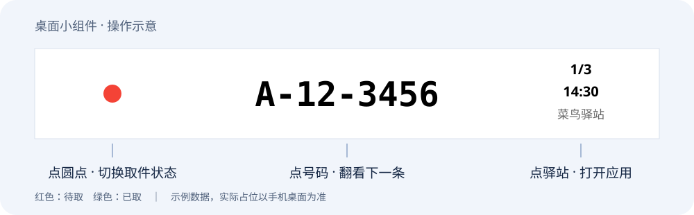
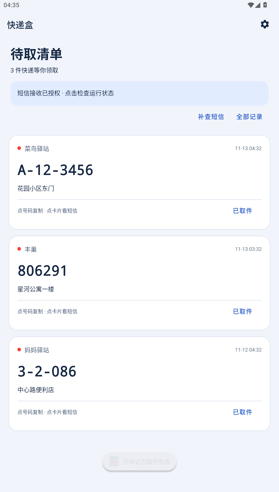
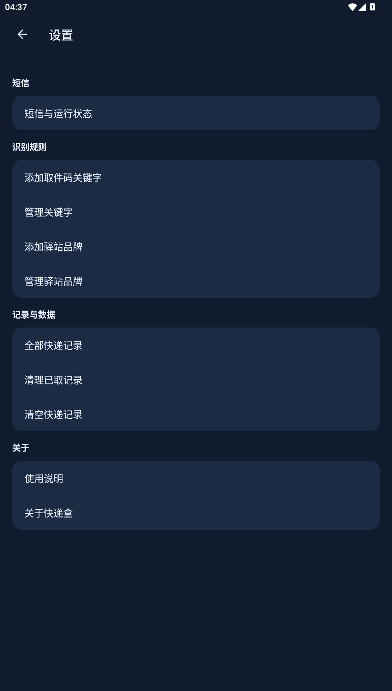
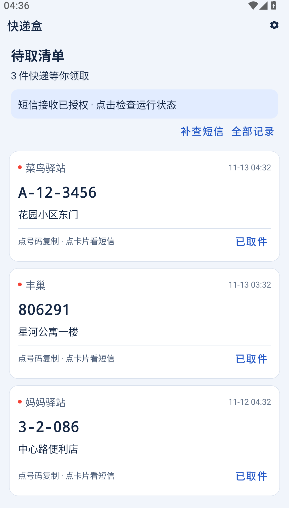

<div align="center">

# 📦 快递盒

**取件码就在桌面上，取快递不用再翻短信。**

以桌面小组件为核心的安卓取件码工具：自动识别普通短信，在桌面查看号码、切换快递、标记已取。

[](#下载安装)
[](https://github.com/siihihh1191125530/kuaidibox/releases)
[](https://github.com/siihihh1191125530/kuaidibox/actions/workflows/android.yml)
[](#隐私与权限)

[下载 APK](https://github.com/siihihh1191125530/kuaidibox/releases/latest) · [小组件使用指南](#桌面小组件) · [更新日志](CHANGELOG.md) · [反馈问题](https://github.com/siihihh1191125530/kuaidibox/issues)

</div>

## 桌面小组件

**把快递盒放到桌面，出门前看一眼，到驿站直接亮出取件码，取完点一下圆点。** 日常查看号码、翻看其他快递和切换取件状态，都可以在小组件上完成。

<p align="center">
  
</p>

这是功能示意图，不是桌面截图；实际占位和显示效果由手机桌面网格决定。**本次保留原版小组件的尺寸配置与布局。**

### 怎么添加到桌面

1. 安装并打开快递盒，在 **设置 → 短信与运行状态** 开启“接收新短信”。建议同时开启读取权限，点击“立即补查”。
2. 回到手机桌面，长按空白区域，进入 **小组件 / 窗口小工具 / 桌面插件**。
3. 找到 **快递盒**，将小组件拖到桌面空白处。具体入口名称以手机桌面为准。
4. 有取件记录时显示取件码；没有可展示的记录时显示“暂无待取”，点击即可打开应用。

### 小组件怎么操作

| 位置 | 显示内容 | 点击效果 |
| --- | --- | --- |
| 左侧圆点 | 红色代表待取，绿色代表已取 | 直接切换当前快递的取件状态；误点后再点一次可恢复 |
| 中间大号码 | 当前快递的取件码 | 循环切换到下一条快递，方便连续取多个包裹 |
| 右侧页码 | 当前第几条 / 可展示的记录总数 | 用于查看翻页位置 |
| 右侧时间 | 短信接收时间 | 帮助区分记录 |
| 右侧驿站 | 识别出的驿站或快递来源 | 打开应用，查看完整清单 |

**小组件点号码是翻页；应用内点号码才是复制。** 在桌面点击圆点会直接改变状态，不弹出确认框。

### 多个小组件与已取记录

- **每个小组件独立翻页**：可以在不同桌面页分别放置，切换其中一个不会强制其他组件跳到相同页码。
- **记录与状态共享**：多个组件使用同一份快递清单；在任意组件标记已取，其他组件也会更新该记录的状态。当前不支持按驿站为组件分别筛选。
- **已取后保留 24 小时**：刚取完的记录会以绿色圆点继续显示，方便核对或恢复；超过 24 小时后，在后续刷新时从组件移出。历史记录仍可在应用里查看。
- **页码总数不等于待取件数**：它包含待取记录，以及上述保留期内的已取记录。

### 不显示、不更新怎么办

1. **先打开应用看清单**：应用里也没有记录时，检查短信权限，点击“立即补查”，并确认收到的是普通短信。
2. **应用有记录，桌面没变化**：回到桌面检查；仍未更新时，移除小组件后重新添加。移除桌面组件不会删除应用中的快递记录。
3. **检查后台限制**：按手机实际情况允许自启动、放宽电池限制；被系统“强行停止”后，需要重新打开应用。

识别到取件短信后会触发小组件刷新，但后台调度和桌面刷新仍受系统与厂商策略影响，不能保证任何手机上都即时更新。已有系统小组件 Host 的翻页和状态操作测试，仍欢迎反馈不同品牌桌面的兼容问题。

## 自动识别，让桌面有内容可看

- **自动整理**：接收普通短信，识别取件码、驿站和地址；支持一条短信中的多个取件码。
- **应用内管理**：点击号码复制，查看原短信，标记已取；在全部记录中筛选、恢复或删除。
- **漏收补查**：可选读取短信库，首次检查最近 7 天，以后增量补查；支持手动补查与后台恢复任务。
- **清楚易读**：取件票式卡片、浅色与深色模式、大字号适配，以及集中的短信权限与运行状态页。
- **本地使用**：无需账号、无广告、无网络权限；无需无障碍服务和通知使用权。

## 应用内界面预览

<p align="center">
  
  
  
</p>

<p align="center">实际运行截图，地址与号码均为演示数据。</p>

## 下载安装

适用于 **Android 8.0 及以上**。手机需要具备短信能力并允许应用获得短信权限。

1. 打开 [最新发布页](https://github.com/siihihh1191125530/kuaidibox/releases/latest)。
2. 在 **Assets** 中下载 `kuaidibox-1.0-rebuild.1.apk`，不要下载 `Source code`。
3. 允许此次安装来源，安装后打开快递盒，按下面的步骤开启短信识别。

### 原版用户请先看这里

本次以 **1.0 重制版** 重新发布，标签为 `v1.0.0-rebuild.1`。原版 `v1.0.0` 保留在历史发布记录中。

**重制版使用新的发布签名，无法覆盖安装原版或此前的调试包。** Android 可能提示“与现有应用冲突”。如决定重新安装，请先自行记录仍需保留的取件信息：**卸载会清除本地记录和设置**。重新安装后可补查最近 7 天短信，但不能恢复旧的已取状态或全部历史记录。

后续版本将沿用重制版签名。数据库包含旧数据迁移逻辑，但迁移不能绕过 Android 的签名校验。

## 一分钟开始使用

1. 打开 **设置 → 短信与运行状态**，授权“接收新短信”。这是新短信自动识别的必要权限。
2. 建议同时授权“补查短信”，点击“立即补查”，导入最近的取件短信。
3. 按需开启取件提醒；关闭提醒不影响识别。
4. 在手机桌面长按空白区域，找到系统“小组件/插件”，添加快递盒。
5. 来信后查看取件码，取完后标记“已取”。误操作可在全部记录中恢复。

不同手机的入口名称可能不同。若有漏收，请先查看应用内的权限状态和最后补查结果，再检查手机的自启动与电池限制。

## 隐私与权限

| 权限或能力 | 用途 | 是否必需 |
| --- | --- | --- |
| 接收短信 `RECEIVE_SMS` | 在普通短信到达时识别取件信息 | 自动接收需要 |
| 读取短信 `READ_SMS` | 补回最近遗漏的取件短信 | 可选，建议开启 |
| 通知 `POST_NOTIFICATIONS` | 发送新取件码提醒 | 可选 |
| 开机广播 | 恢复短信补查任务的调度 | 系统能力 |

应用仅在本机处理短信，保存识别出的快递信息、原短信、来源和取件状态；非快递短信不写入应用数据库。去重凭据只保存摘要和时间，删除快递记录后仍保留凭据，避免补查将其重新加入。需要完整重置时，可在系统设置中清除应用数据。

应用未申请网络权限，默认关闭 Android 应用自动备份，不通过应用上传短信；不读取联系人，不发送短信，不监听其他 App 通知。

## 常见问题

**为什么不再需要无障碍权限？**
重制版直接接收系统短信广播，并通过短信库补查遗漏。安装后请在新的短信设置页授权。

**能一直后台保活吗？**
短信识别不要求常驻界面。后台补查按每小时周期请求系统调度，但省电、休眠和厂商策略都可能推迟执行，不保证整点运行或永久保活。被“强行停止”后，需要重新打开应用。

**微信、淘宝推送或 5G 消息能识别吗？**
当前只支持普通短信。不支持其他 App 推送，也不支持未写入系统短信库的 RCS/5G 网络消息。

**短信权限无法开启，或者仍然漏收？**
先确认收到的是普通短信，再检查系统应用设置中的短信授权、自启动与后台限制。部分安装器或厂商会限制短信权限；应用不能绕过这些限制。有读取权限时，可以打开应用或点击“立即补查”。

**某种取件短信识别不出来？**
可以在设置中补充识别关键字。仍有问题时，请在 [Issues](https://github.com/siihihh1191125530/kuaidibox/issues) 提供脱敏示例、手机型号、Android 版本及复现步骤。请替换真实手机号、地址、取件码和运单号。

## 开发与验证

原生 Android 项目：Kotlin、XML Views、Material、Room、Hilt、WorkManager。最低 Android 8.0，编译与目标 SDK 34。

```bash
./gradlew :app:assembleDebug :app:testDebugUnitTest :app:lintDebug
```

Windows 使用 `gradlew.bat`。环境配置、设备测试及签名流程见 [构建指南](docs/BUILD.md)。

本轮通过 16 项 JVM/数据库测试和 3 项 Android 15 模拟器功能测试，涵盖解析、去重、删除后补查、数据库迁移、小组件及记录操作。**运营商真实来信、双卡、长短信和各品牌锁屏过夜仍需真机验证**，详见 [验证记录](docs/VALIDATION.md)。

## 关于项目

这是一个借助 AI 辅助开发的个人项目，欢迎通过 Issue 或 Pull Request 改进识别规则与设备兼容性。

发布文档参考了 [Parcel](https://github.com/shareven/parcel) 的下载与使用指引，以及 [SmsForwarder](https://github.com/pppscn/SmsForwarder) 的版本与反馈入口组织方式。界面设计过程见 [设计说明](docs/DESIGN.md)。
